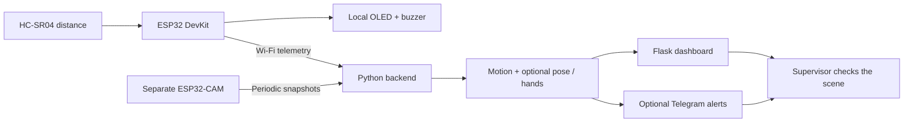
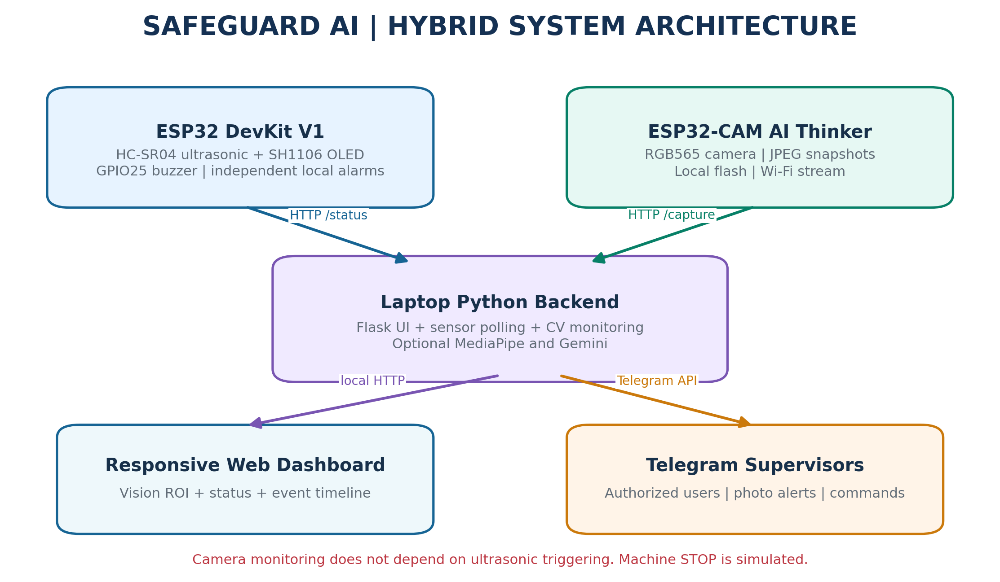
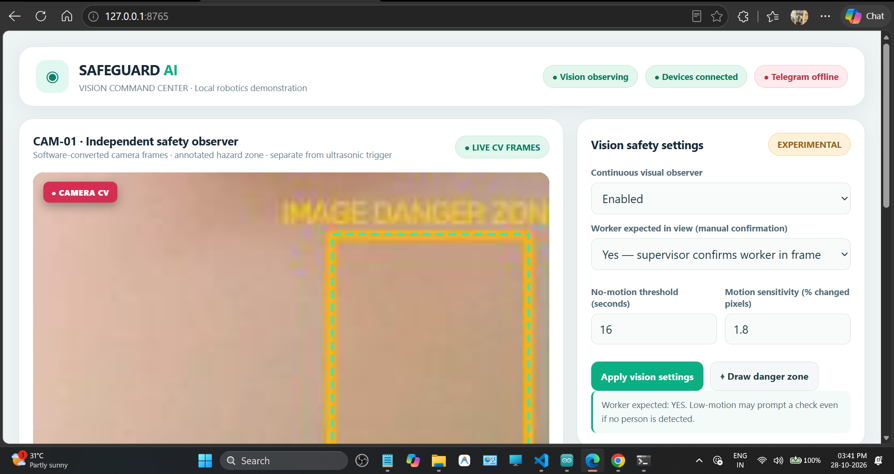
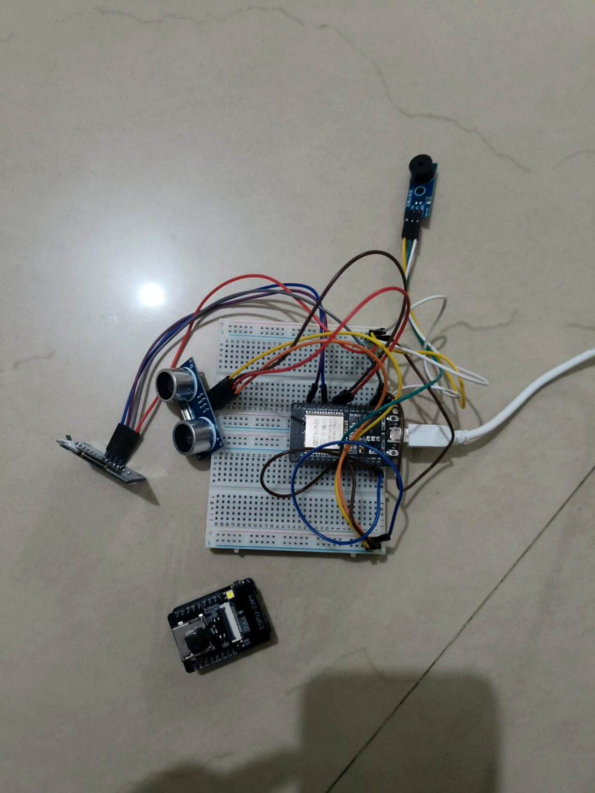
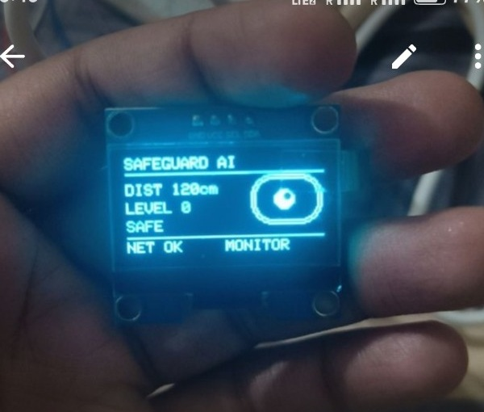
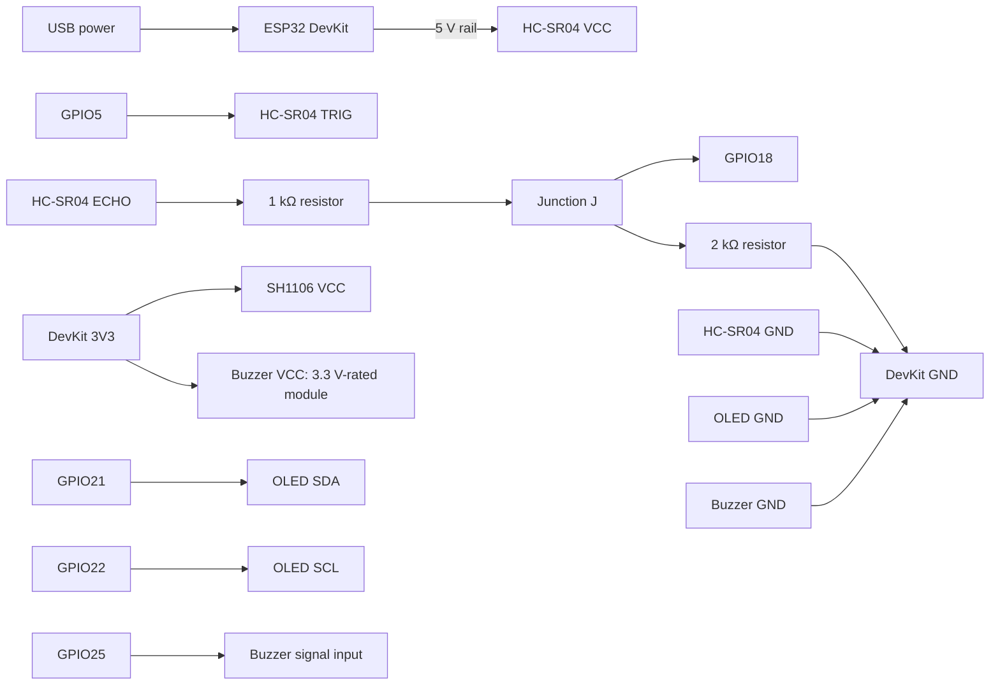

<div align="center">


# SafeGuard AI 🛡️

**IoT-Based Industrial Safety Gatekeeper**<br>
Independent vision monitoring · Local proximity alarms · Supervisor alerts


[](https://github.com/KING-OF-FLAME/SafeGuard-AI-IOT/actions/workflows/tests.yml)

[Quick start](#-quick-start) · [Hardware](#-hardware--wiring) · [SafeGuard distance demo](https://wokwi.com/projects/479121451547351041) · [Technical guide](docs/TECHNICAL_GUIDE.md)

</div>

## 🎯 The problem

A distance sensor sees only what is in front of it. A worker could fall, stop moving, or reach into a risky area outside that narrow view. A camera alone can also miss events when visibility or connectivity is poor.

**SafeGuard AI combines two independent observers to help a supervisor notice possible hazards:**

- **Someone approaches the sensor →** the ESP32 gives graded OLED and buzzer warnings.
- **Low movement in an occupied scene →** the camera observer raises a “check worker” advisory.
- **Possible fall or hand-zone entry →** optional pose/hand tracking flags the event for review.
- **Supervisor needs context →** the dashboard and optional Telegram bot provide status, snapshots and events.

> Educational monitoring prototype. It does not diagnose injury, stop machinery, or replace certified guards and emergency stops.

## ✨ Key features & innovations

- **Two independent paths:** local distance alarms keep working without the camera, laptop or internet.
- **Camera checks without a distance trigger:** visual observation runs on its own timer.
- **Presence-aware stillness checks:** a static empty room does not automatically become a worker alert; recent pose detection or supervisor confirmation is required.
- **Optional fall & hand monitoring:** MediaPipe checks posture changes and hands/wrists in a drawn image region.
- **Responsive command center:** live observations, event history, sensitivity, worker-presence controls and danger-zone drawing.
- **Supervisor tools:** allow-listed Telegram commands, photos, short recordings and flash control.
- **Optional Gemini descriptions:** on-demand image interpretation, separate from real-time detection.
- **Fault visibility:** sensor errors and unavailable cameras are shown explicitly.

## 🔄 How it works





## 🖥️ Dashboard & prototype



*Report screenshot: an example development session, not a live service-status indicator.*

<p align="center">
  
  
</p>

## 🔌 Hardware & wiring

**You need:** ESP32 DevKit V1, AI Thinker ESP32-CAM, HC-SR04, SH1106 OLED, buzzer module, 1 kΩ + 2 kΩ resistors, stable power, and a laptop on the same 2.4 GHz Wi-Fi.

### Complete controller connections

| Module pin | Connect to |
|---|---|
| DevKit USB | Laptop / USB supply |
| HC-SR04 VCC / GND | Verified DevKit 5 V rail / DevKit GND |
| HC-SR04 TRIG | GPIO5 |
| HC-SR04 ECHO | **1 kΩ resistor → junction J → GPIO18** |
| Junction J | **2 kΩ resistor → DevKit GND** |
| SH1106 VCC / GND | 3V3 / DevKit GND |
| SH1106 SDA / SCL | GPIO21 / GPIO22; I2C address `0x3C` |
| Compatible 3-pin buzzer S / I/O | GPIO25 |
| Buzzer VCC / GND | 3V3 **if rated for it** / DevKit GND |

**All controller-side grounds join DevKit GND.** For a buzzer requiring a different supply or higher current, use a suitable driver; do not power its load from a GPIO.



The ECHO divider gives about **3.33 V from nominal 5 V**. ESP32 GPIO is not 5 V tolerant; check actual voltages and resistor tolerances, or use a suitable level shifter. A bare/high-current buzzer needs a driver. Match the module's rating and pin labels.

### Separate ESP32-CAM connections

| Camera pin | Normal operation |
|---|---|
| 5V / GND | Stable regulated 5 V supply / that supply's GND |
| Camera ribbon | Onboard camera socket |
| GPIO4 flash LED | Already onboard; no external wire |
| GPIO0 | Remove GPIO0-to-GND flashing jumper, then reset |
| Data link | Same 2.4 GHz Wi-Fi as laptop and DevKit |

**No direct GPIO connection between the DevKit and camera. Do not power the camera from DevKit 3V3.** For flashing only: adapter **TX → U0R (GPIO3)**, **RX → U0T (GPIO1)**, **GND → GND**, and temporarily **GPIO0 → GND**. UART logic must be **3.3 V**, even when camera power is 5 V. Use one suitable camera power source.

**[Full wiring guide: power rails, divider, buzzer drivers, camera flashing and all onboard camera pins →](docs/WIRING.md)**

### Flash the boards

1. Install Arduino IDE and **Arduino-ESP32 3.x**.
2. For `esp32/esp32.ino`, choose **ESP32 Dev Module**. Install **Adafruit SH110X** and **Adafruit GFX** libraries.
3. For `esp32_cam/esp32_cam.ino`, choose **AI Thinker ESP32-CAM**; keep `camera_dashboard.h` alongside it and enable PSRAM when supported.
4. Set your Wi-Fi name/password locally in both sketches. Review the static IP/gateway settings; disable `STATIC_IP` (DevKit) / `USE_STATIC_IP` (camera) if they do not match your LAN.
5. Upload; read each board’s IP in Serial Monitor at **115200 baud**. Remove the camera’s GPIO0-to-GND flashing jumper and reset after upload.

The DevKit defaults to a passive buzzer. Set `PASSIVE_BUZZER=false` locally if using an active module. See the [technical guide](docs/TECHNICAL_GUIDE.md) for details.

## 🚀 Quick start

**Python 3.11 or 3.12 recommended.** Clone the repository and create a virtual environment:

```bash
git clone https://github.com/KING-OF-FLAME/SafeGuard-AI-IOT.git
cd SafeGuard-AI-IOT
python -m venv .venv
```

**Activate and install — Windows:**

```bat
.venv\Scripts\activate
python -m pip install -r requirements.txt
copy .env.example .env
```

**Activate and install — Linux / macOS:**

```bash
source .venv/bin/activate
python -m pip install -r requirements.txt
cp .env.example .env
```

Edit `.env` locally:

| Setting | What to enter |
|---|---|
| `ESP32_URL` | DevKit address from Serial Monitor, e.g. `http://192.168.1.100` |
| `CAMERA_URL` | Camera address, e.g. `http://192.168.1.101` |
| `TELEGRAM_BOT_TOKEN` | Your bot token; leave the placeholder for dashboard-only use |
| `TELEGRAM_USER_IDS` | Comma-separated numeric IDs allowed to control the bot |
| `GEMINI_API_KEY` | Optional key for image descriptions |
| `WORKER_EXPECTED` | Keep `false` until a supervisor confirms someone is in view |

Keep `.env` private. Use fresh credentials; rotate any keys or Wi-Fi passwords previously shared in an archive.

**Optional pose/hand detection:**

```bash
python -m pip install -r requirements_vision_optional.txt
```

Without compatible MediaPipe, basic motion monitoring remains available; fall/hand landmark detection is unavailable.

**Check devices, then start:**

```bash
python verify_devices.py
python m.py
```

Open **http://127.0.0.1:8765/** on the laptop. Keep the backend running. Without connected boards, the dashboard can open, but device checks and live monitoring will be unavailable. Keep the dashboard bound to localhost; it has no public-facing login.

## 🎮 Use it

1. Check the device and camera status badges.
2. Confirm **Worker expected in view** only after checking the scene.
3. Adjust the stillness duration and motion sensitivity for a controlled demonstration.
4. Draw an image danger zone if optional hand/pose tracking is available.
5. Review advisories and verify the worker’s condition yourself.

| Telegram command | Purpose |
|---|---|
| `/start`, `/status` | Menu and current observations |
| `/vision on`, `/vision off` | Toggle camera monitoring |
| `/worker on`, `/worker off` | Set expected worker presence |
| `/still 20` | Set the stillness threshold to 20 seconds |
| `/zone 0.55 0.15 0.95 0.85` | Set normalized image-region coordinates |
| `/photo`, `/record 8` | Snapshot or short recording |
| `/flash on`, `/flash off` | Camera flash control |
| `/analyze` | Optional Gemini image description |

Telegram requires internet, a valid token and allowed user IDs. Run only one polling backend per bot. Full commands and troubleshooting: [technical guide](docs/TECHNICAL_GUIDE.md).

## 🚦 Distance demonstration

| Target distance | Local status |
|---|---|
| ≥ 100 cm | 🟢 Safe |
| 60–99 cm | 🟡 Caution |
| 40–59 cm | 🟠 Warning |
| < 40 cm | 🔴 Critical after two consecutive close readings; first reading is warning |
| Invalid / missing echo | ⚠️ Sensor error |

These are demo thresholds, not calibrated machine stopping distances.

<p align="center">
  <a href="https://wokwi.com/projects/479121451547351041"></a><br>
  <a href="https://wokwi.com/projects/479121451547351041"><b>▶ Try the Wokwi simulation</b></a>
</p>

Wokwi demonstrates the **distance branch only** using an SSD1306 display and two-pin piezo. The physical build uses SH1106 and a buzzer module. Camera, Python, Telegram and Gemini are not simulated.

## 📁 Project files

```text
├── m.py                         # Flask backend, telemetry and Telegram
├── vision_monitor.py            # Motion and optional landmark checks
├── verify_devices.py            # Live board connectivity checks
├── esp32/                       # Proximity controller firmware
├── esp32_cam/                   # Camera firmware and dashboard header
├── assets/                      # Web dashboard interfaces
├── tests/                       # Offline backend and vision tests
├── docs/                        # Wiring guide, diagrams and detailed setup
├── .env.example                 # Configuration template; no real credentials
└── requirements*.txt            # Base and optional vision dependencies
```

## 🧪 Tests & current limits

```bash
python -m unittest discover -s tests -v
```

- **12 offline tests passed** with real Flask, NumPy and OpenCV. Pose/hand tests use simulated landmarks.
- Dashboard HTTP/API smoke checks passed without hardware or cloud credentials; see [validation details](VALIDATION_REPORT.md).
- Physical board uploads, actual MediaPipe detection and Telegram/Gemini delivery require separate testing.
- The current camera captures **160 × 120 RGB565** and converts to JPEG in software. Lighting, frame rate and occlusion limit vision reliability.
- No measured fall-detection accuracy or guaranteed alert latency is claimed. The drawn ROI is an image region, not a calibrated physical boundary.

## 📚 Documentation

- [Complete physical wiring & camera programming](docs/WIRING.md)
- [Detailed setup, commands & troubleshooting](docs/TECHNICAL_GUIDE.md)
- [Validation status](VALIDATION_REPORT.md)

Diagrams and prototype photos above come from the supplied project report. The original PDF/Word reports are not published in this repository.

## 🔗 SafeGuard AI repository QR

<p align="center">
  <a href="https://github.com/KING-OF-FLAME/SafeGuard-AI-IOT/"></a><br>
  <a href="https://github.com/KING-OF-FLAME/SafeGuard-AI-IOT/"><b>Scan to open SafeGuard-AI-IOT on GitHub</b></a>
</p>

---

## 🚥 Separate project: Traffic Simulation By Yash Raj Group

> **An independent Arduino Uno traffic-light project on Tinkercad. It is not part of SafeGuard AI, its wiring, firmware, or validation.**

- **Platform:** Autodesk Tinkercad Circuits.
- **Circuit:** Arduino Uno, breadboard, red/yellow/green LEDs and resistors.
- **Purpose:** demonstrate a traffic-light sequence as a separate robotics exercise.

<p align="center">
  <a href="https://www.tinkercad.com/things/6tYz1gtD3ZU-traffic-simulation-by-yash-raj-group"></a><br>
  <a href="https://www.tinkercad.com/things/6tYz1gtD3ZU-traffic-simulation-by-yash-raj-group"><b>Open the separate Traffic Simulation project ↗</b></a>
</p>

---

## 👨‍💻 Developer

**[Yash Raj](https://github.com/KING-OF-FLAME)**<br>
Developer & repository maintainer · [@KING-OF-FLAME](https://github.com/KING-OF-FLAME)
