# Project media gallery

Original project images extracted from the supplied **SafeGuard_AI_Robotics_Report_Final.docx** and **SafeGuard_AI_Robotics_Report_Corrected_v2.pdf**. Images retain their embedded resolution and bytes; they have not been stretched, cropped, or re-encoded. GitHub only scales their display size.

These are supplied development images, not new hardware tests. Diagrams illustrate the design; use the [complete wiring guide](WIRING.md) for exact physical connections.

## SafeGuard AI — architecture and operation

### Independent sensor and camera branches

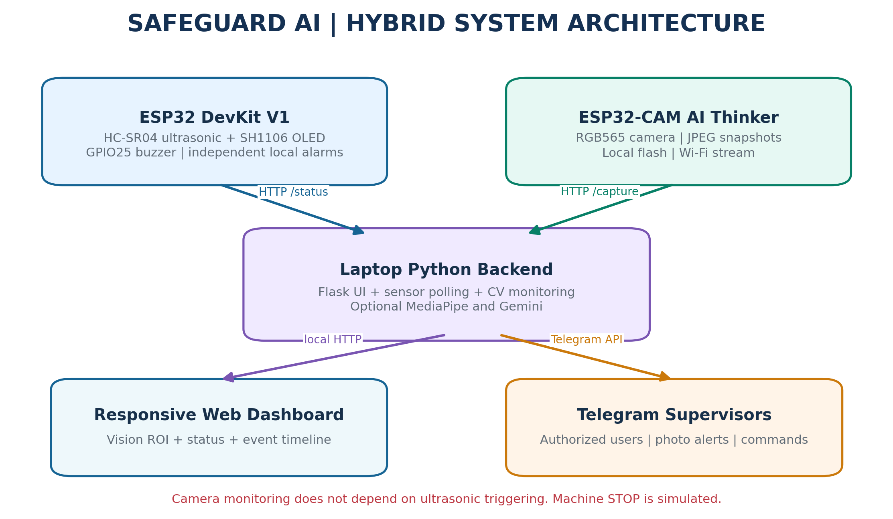

### Observation and supervisor response workflow

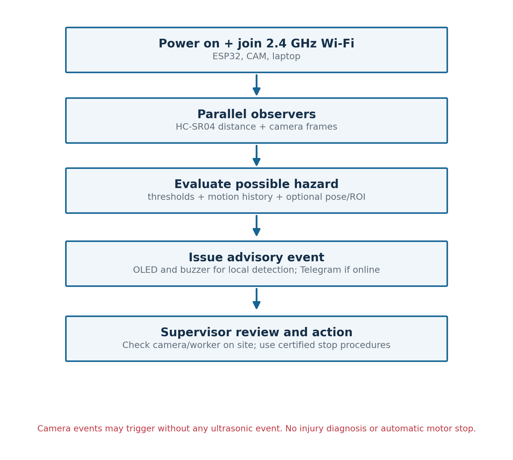

### Separate camera node and laptop processing

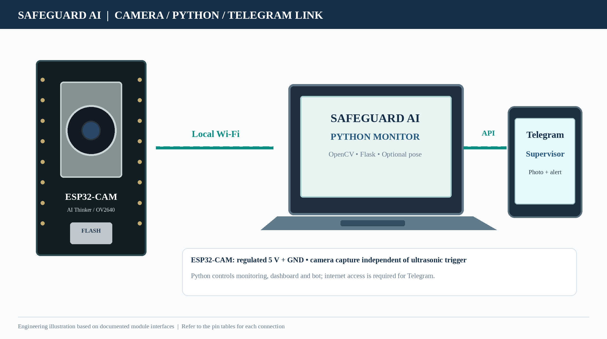

## SafeGuard AI — components and wiring references

### Component identification

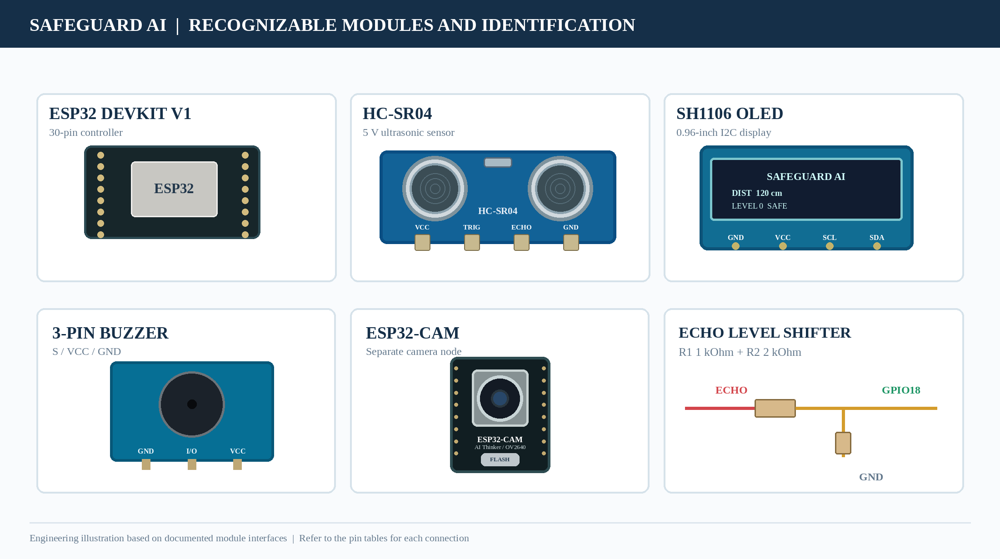

### Controller connection overview

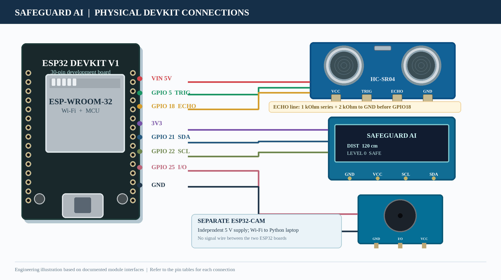

This is a module-level illustration. Power, ground, buzzer-driver compatibility, camera programming and the full ECHO divider are documented in [WIRING.md](WIRING.md).

### ECHO voltage divider

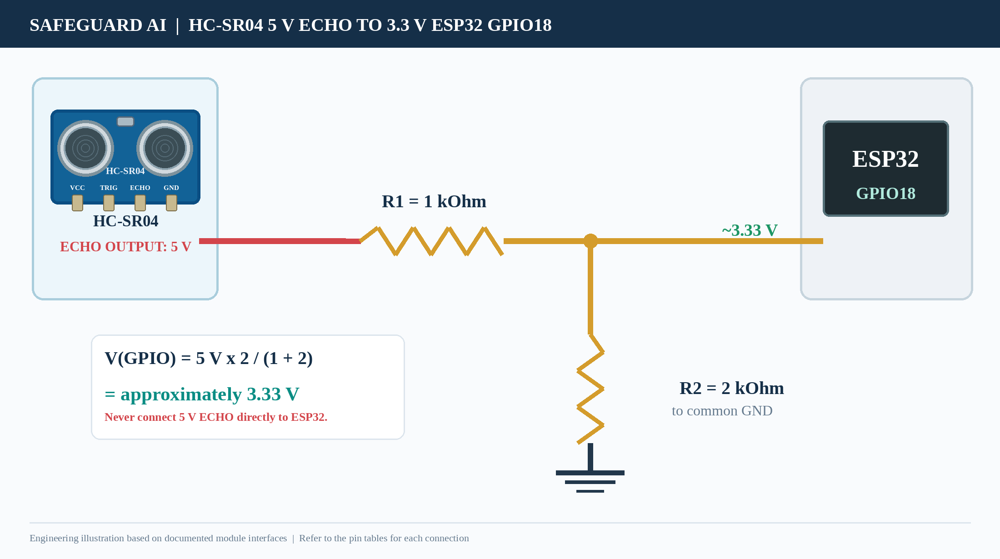

## SafeGuard AI — physical prototype photos

| Breadboard prototype and separate camera | OLED display |
|---|---|
| 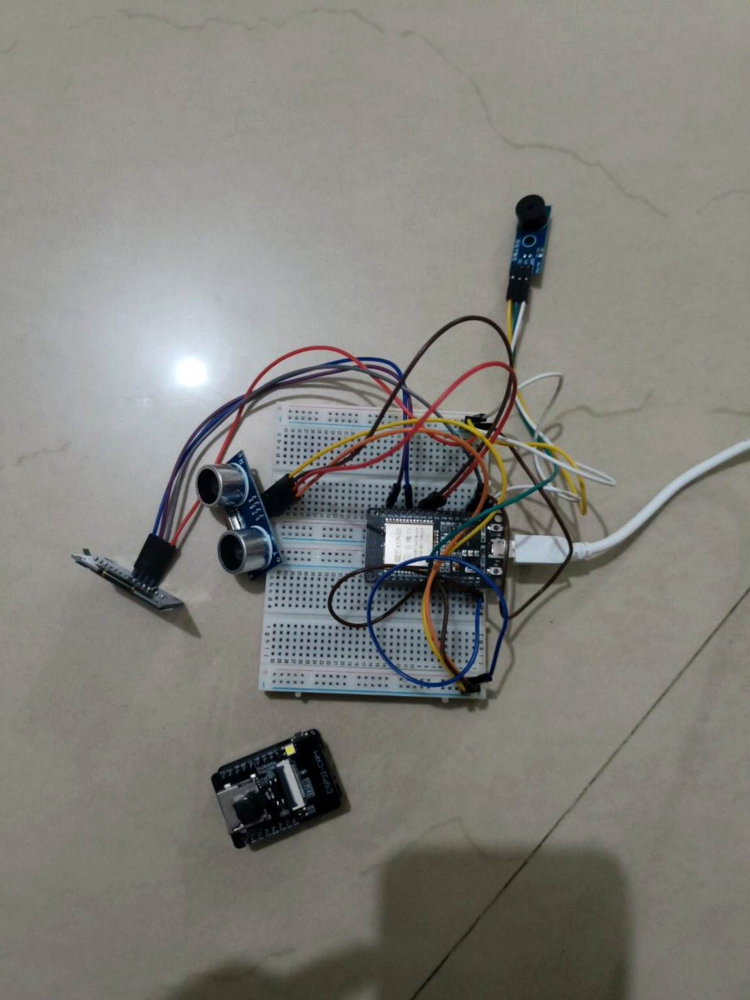 | 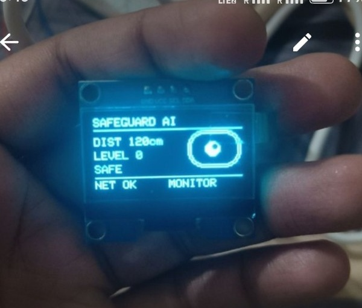 |

Photos document the supplied assembly; they do not verify resistor connections, supply voltages or electrical safety.

## SafeGuard AI — dashboard

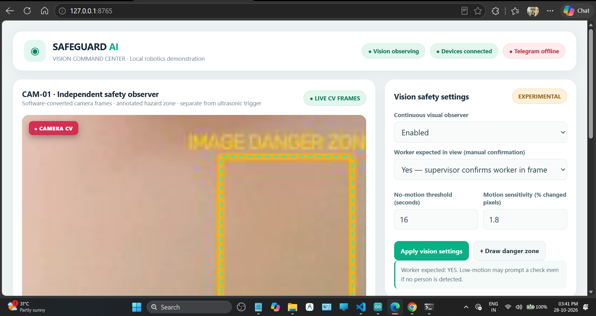

Shows one development session, including service status at the time of capture. It is not a live status display.

## SafeGuard AI — Wokwi distance demonstration

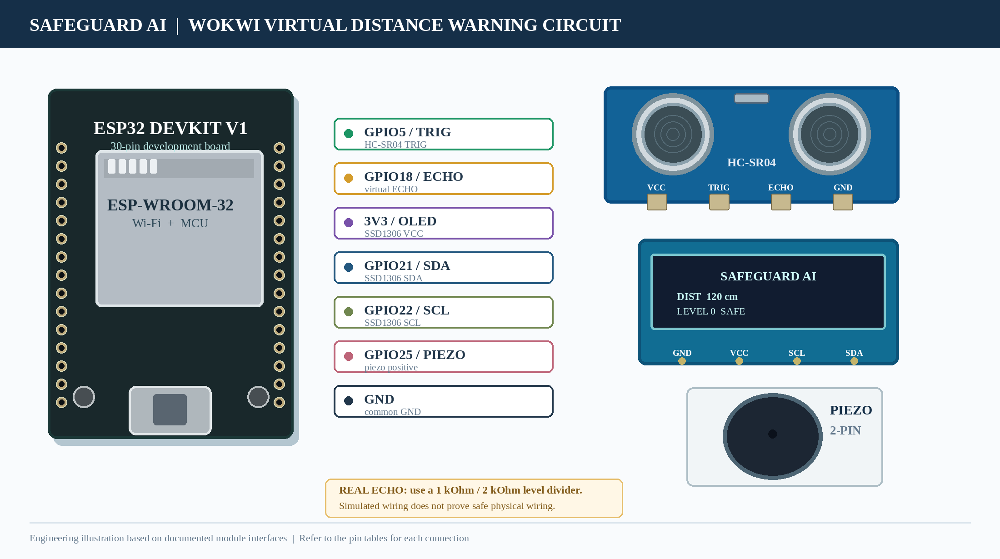

[Open SafeGuard's Wokwi distance demo](https://wokwi.com/projects/479121451547351041). It models the distance branch with a simulated SSD1306 and two-pin piezo, not the physical camera/Python/Telegram system.

| SafeGuard Wokwi demo | SafeGuard GitHub repository |
|---|---|
|  |  |

---

## Separate project — Traffic Simulation By Yash Raj Group

**This Arduino Uno traffic-light exercise is independent of SafeGuard AI.** Its media is shown here separately and is not SafeGuard wiring or validation.

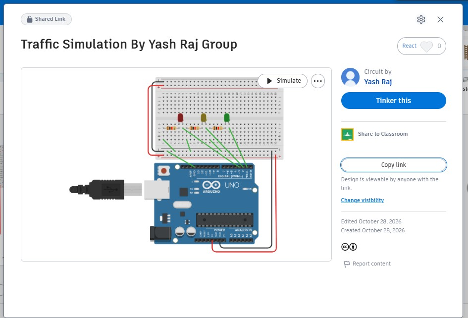

Original screenshot extracted from **page 27 / Appendix A** of the corrected PDF. It is the project view supplied by the user, not a recreation.

[Open the independent Tinkercad traffic simulation](https://www.tinkercad.com/things/6tYz1gtD3ZU-traffic-simulation-by-yash-raj-group)

## Extraction record

[media-sources.json](media-sources.json) records the document, embedded-image path, dimensions and SHA-256 for each extracted image. Existing generated banner and repository/traffic QR graphics are separate assets. Original PDF/Word report files are not included in the public repository.
